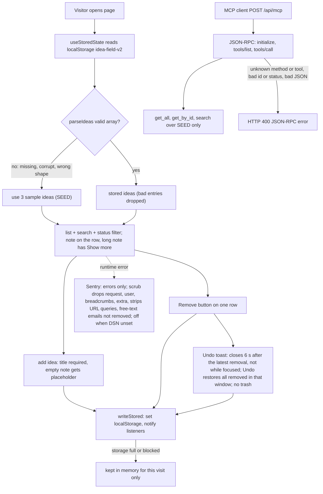

# 01 — Business process (As-Is / To-Be)

Idea Field คือสมุดไอเดียที่ทำงานในเบราว์เซอร์ล้วน (Next.js บน Vercel) ให้ผู้เยี่ยมชมหรือ owner เพิ่มไอเดียพร้อมสถานะ (Seed, Shaping, Testing, Parked) ค้นหา กรอง อ่าน และลบได้ ข้อมูลอยู่ใน localStorage ของเบราว์เซอร์เท่านั้น ส่วน `/api/mcp` ตอบเฉพาะไอเดียตัวอย่าง

Last reviewed: 2026-11-28 · commit `9873d06`

## As-Is (จากโค้ดวันนี้)

Sources: `app/page.tsx`, `lib/ideas.ts`, `lib/use-stored-state.ts`, `app/api/mcp/route.ts`, `lib/sentry.ts`, `instrumentation.ts`, `next.config.ts`, `README.md`, `PRODUCT.md`

ข้อเท็จจริงสำคัญจากโค้ด:

- `/more-projects` ตอบ 308 ไป `https://bookchaowalit.com/` (`next.config.ts`)
- ไอเดียของผู้เยี่ยมชมไม่เคยออกจากเบราว์เซอร์ (ยกเว้นรายงานข้อผิดพลาดไป Sentry ตามที่ scrub อนุญาต): MCP route มองไม่เห็นข้อมูลนั้น
- CI (GitHub Actions บน push/PR) แยกจากการ deploy: ไม่มี workflow ที่ deploy
- การ deploy: Vercel CLI ตาม `PRODUCT.md`; push ไป `main` ไม่ deploy ถ้า Git ยังผูก repo เก่า [ต้องยืนยัน]

## To-Be (ไม่มีแหล่งที่เขียนไว้)

ไม่มี To-Be ที่เขียนไว้

## Gap

| ID | As-Is → To-Be | Status | Owner | Evidence |
|---|---|---|---|---|
| G1 | Vercel Git ผูกกับ repo เก่า ผลิตจริงถูก deploy ด้วย CLI เท่านั้น (push main ไม่ deploy) → Vercel Git ผูกกับ repo นี้ เพื่อให้ push main = deploy | decide | owner | `PRODUCT.md` §Live URL and deploy state (owner action D9) [ต้องยืนยัน: สถานะวันนี้ต้องเช็กใน Vercel] |
| G2 | ไม่มี To-Be ของกระบวนการเขียนไว้ → owner กำหนดเป้าหมาย (ฟีเจอร์/ขอบเขตถัดไป) หรือยืนยันว่า As-Is คือเป้าหมายสุดท้าย | decide | owner | ไม่มีใน `PRODUCT.md` / `README.md` / `specs/` |
